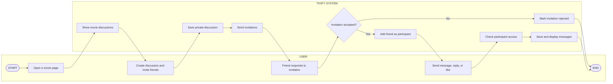

# Tixify

**Tixify** is a proposed movie discovery and cinema ticket booking platform. The updated scope adds private, movie-specific discussions so customers can invite friends and talk about a film.

## User and system workflows

These simple swimlane diagrams show the order of actions. The **USER** lane shows what the customer does; the **TIXIFY SYSTEM** lane shows what the application does. They use GitHub-supported Mermaid syntax.

### Movie booking workflow

```mermaid
flowchart LR
    subgraph USER[USER]
        direction TB
        UStart([START])
        UOpen[Open Tixify website]
        ULogin[Register or log in]
        UBrowse[Browse movies]
        UChooseMovie[Choose a movie]
        UChooseShow[Choose theater and showtime]
        UChooseSeats[Select seats]
        UConfirm[Confirm booking]
        UViewTicket[View or print ticket]
        UEnd([END])
    end

    subgraph SYSTEM[TIXIFY SYSTEM]
        direction TB
        SVerify[Check account details]
        DLogin{"Login details correct?"}
        SLoginError[Show login error]
        SHome[Display home page]
        SMovies[Display movies]
        SShows[Display showtimes]
        SSeats[Display available seats]
        SCheckSeats[Check seat availability]
        DSeats{"Are seats available?"}
        SUnavailable[Show seats unavailable]
        SLock[Hold seats for a short time - proposed]
        SSave[Save booking in MySQL]
        SReceipt[Display booking confirmation and ticket]
    end

    UStart --> UOpen --> ULogin --> SVerify --> DLogin
    DLogin -- No --> SLoginError --> ULogin
    DLogin -- Yes --> SHome --> UBrowse --> SMovies
    SMovies --> UChooseMovie --> UChooseShow --> SShows
    SShows --> SSeats --> UChooseSeats --> SCheckSeats --> DSeats
    DSeats -- No --> SUnavailable --> UChooseSeats
    DSeats -- Yes --> SLock --> UConfirm --> SSave --> SReceipt
    SReceipt --> UViewTicket --> UEnd
```

### Friends movie discussion workflow

**Note:** Temporary seat holds and friends discussions are part of the proposed updated scope. Confirm implementation status before describing them as completed features.

## Main modules

1. **User Authentication and Management** — customer and administrator accounts.
2. **Movie Discovery and Management** — movie browsing, search, filters, and catalog management.
3. **Theater and Show Management** — cities, theaters, screens, seats, and showtimes.
4. **Interactive Seat Selection** — view and choose seats; temporary seat holds are proposed.
5. **Booking and Ticket Confirmation** — bookings, receipts, ticket PDFs, and optional email.
6. **Friends Movie Discussion** — private movie discussions, invitations, and messages; proposed in the updated scope.

## Technology

- Frontend: HTML, CSS, JavaScript
- Backend: Java 21 and Spring Boot REST API
- Database: MySQL
- Local API default: `http://localhost:8081/api`

## Documentation

- [Pre-development synopsis](docs/SYNOPSIS.md)
- [Updated scope and requirements](docs/REQUIREMENTS.md)
- [System design](docs/SYSTEM-DESIGN.md)
- [Database ERD](docs/DATABASE-ERD.md)
- [API reference](docs/API.md)
- [Setup guide](docs/SETUP.md)
- [Verification plan](docs/TEST-PLAN.md)
- [Project plan](docs/PROJECT-PLAN.md)

## Project status

This is an academic project prototype. The synopsis and requirements describe the proposed updated scope. Secure backend authorization, temporary seat locks, transaction-safe reservations, ticket verification, and Friends Movie Discussion need implementation and verification before being called complete. There is no payment gateway in the current scope.
