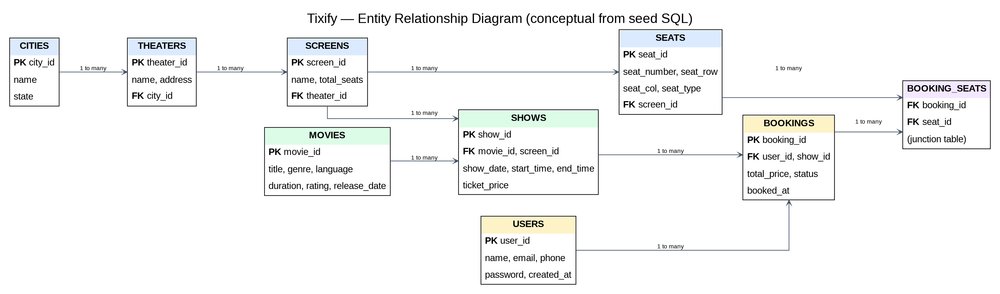

# Tixify — Database Design Overview

The submitted scope specifies MySQL. The local screenshots show a SQL file named `BMS.sql` and entity/repository structures associated with User, City, Movie, Theater, Screen, Seat, Show and Booking. Confirm exact table names, columns, constraints and relationships from SQL and entity mappings.

| Domain | Intended role | Verify |
|---|---|---|
| User | User/account information | Required fields, uniqueness, password handling |
| Movie | Movie metadata | Fields and search/filter support |
| City | City/location | Relationship to theatres |
| Theater | Cinema details | City foreign key |
| Screen | Screen in a theatre | Theatre relationship |
| Show | Scheduled screening | Movie, screen, date/time fields |
| Seat | Seat and state/type | Screen relationship, availability state |
| Booking | Reservation | User/show/seat links, status, duplicate rules |

## Conceptual relationships
- City may contain many theatres.
- Theatre may contain many screens.
- Screen may contain many seats.
- Movie may have many shows.
- Screen may host shows at different times.
- User may have many bookings.
- Booking-to-seat cardinality depends on the actual schema.

## Validation checklist
- [ ] Compare SQL tables to entity mappings.
- [ ] Confirm primary/foreign keys and unique constraints.
- [ ] Confirm booking status and seat type values.
- [ ] Verify seat availability updates and duplicate-booking behavior.
- [ ] Test initialization from a clean database.
- [ ] Remove passwords and private data before publishing.

Never commit real database credentials. Use local environment variables or an untracked configuration file.

## Entity Relationship Diagram (ERD)

The diagram summarizes the relationships indicated by the supplied seed SQL columns and references. The intended paths are: City → Theater → Screen → Seat; Movie + Screen → Show; User + Show → Booking; and Booking ↔ Seat through `booking_seats`. The `booking_seats` table acts as a junction between bookings and seats.

**Schema note:** the supplied material is a seed-data script rather than the full `CREATE TABLE` DDL. Primary-key names shown in the diagram follow the referenced ID conventions and should be checked against the actual table definitions and JPA mappings before treating this as the final physical ERD.
